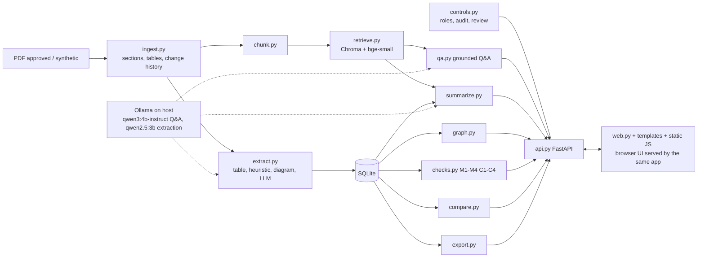

# AUTOSAR HLD Document Analysis Assistant

## Current local verification and upgrades (15 October 2026)

The latest work and its evidence are described in `docs/UPGRADE_VERIFICATION.md`. The historical evaluation below
belongs to the earlier build; it is not a fresh accuracy claim for this version.

On this prepared Windows checkout, run `./start.ps1` to check readiness and launch at `http://127.0.0.1:8000`.
For a structural demo without answer models, use `./start.ps1 -EvidenceOnly -PrepareSynthetic`.
`./start.ps1 -Setup` installs the pinned Python environment (`requirements.lock.txt`, verified on Python 3.12).
Full mode also needs the embedding weights and the configured Ollama models; installing Python packages alone does
not install model weights. The launcher can start the portable runtime in `tools/ollama` when present.

Reviewers can now open **Architecture → Review / edit** to correct fields, record a reason, approve, or reject an
entity. Field corrections persist across extraction runs. Changed machine facts require a fresh review; rejected
and no-longer-rediscovered entities are excluded from inventory-backed answers, new reports, checks, and graphs.
Stored reports remain historical snapshots. The inventory coverage note states extraction limitations explicitly.

For shared access, configure `HLD_AUTH_TOKEN_HASHES` as a JSON mapping of existing usernames to SHA-256 access-token
hashes in `.env`, then restart. Generate long random tokens and give each person only their token; never put tokens
or hashes into source control. The browser then uses `/login` with an HttpOnly session cookie, and API clients can
use `Authorization: Bearer <token>`. Demo `X-User` headers and identity cookies cannot impersonate users in this mode.
Use HTTPS in front of the service when exposing it beyond localhost. This is optional local token authentication;
enterprise SSO and organisation account provisioning remain outside this pilot.

`docs/INDEPENDENT_EVALUATION.md` specifies the independent document annotation and timed reviewer study still needed
before claiming real-world accuracy or time saved.

A local, project-scoped assistant for architecture review. It ingests approved (or synthetic) AUTOSAR high-level
design PDFs, extracts a component / port / interface / signal inventory, builds a dependency graph, runs rule-based
consistency checks, compares revisions, answers questions with page-level citations, writes cited component reports
and summaries, and exports reviewed results. Everything runs on one laptop with local models (Ollama), no cloud API
and no API keys.

## Problem

Architects and reviewers spend a lot of time reading long HLD PDFs to answer "which ports does this component have?",
"what changed between releases?" and "is anything inconsistent?". Generic chatbots are unsuitable for this material:
they cannot be pointed at approved documents only, they do not cite pages, and proprietary documents must not leave
the machine. This pilot shows that a small local system can do the reading, with every output cited, labelled
`unreviewed`, and approved or rejected by a human.

## Architecture



```
PDF -> ingest -> processed JSON -> chunk -> Chroma (one collection per project)
                      |-> extract (table | heuristic | diagram | llm) -> SQLite -> graph, checks, compare, export
Question -> retrieve (threshold 0.65) -> local LLM, labelled chunks only -> drop uncited sentences -> confidence
FastAPI (X-User header, role + project membership on every call)  <-  browser UI (HTML/CSS/JS served by the same
                                                                     FastAPI app; it only calls the JSON API)
```

Every stored entity, finding, report and answer carries a citation (doc_id, version, page, section) and a
`review_status` that starts at `unreviewed`.

## Local-only design

- LLM: Ollama on the same machine: `qwen3:4b-instruct` for Q&A, reports and summaries (`DEMO_MODEL`), `qwen2.5:3b` for
  LLM extraction (`LLM_EXTRACT_MODEL`); both fit a 4 GB GPU at least partly. No API keys exist in the code or config.
- Embeddings: `BAAI/bge-small-en-v1.5` from the local Hugging Face cache; a deterministic hashing embedder is the
  fallback (Q&A refuses to answer on it).
- After the first model download the whole pipeline works offline (checked with a socket-blocking test, see
  `docs/DEMO_CHECK.md`; the network adapter was not physically unplugged).
- UI: plain HTML, one CSS file and small ES modules served by the API itself; fonts (IBM Plex) and the graph library
  (vis-network, inlined by pyvis) are vendored, so the browser makes no request outside `localhost:8000`.
- Controls: only `approved` / `synthetic` source status is accepted (others rejected and audit-logged), project
  isolation (separate Chroma collection and `project_id` scope), roles viewer < reviewer < admin, audit log.

## Data sources

- Real: five AUTOSAR "Explanation of Application Interfaces" PDFs (Body and Comfort R3.1.5 / R3.2.3, Chassis
  R3.1.5 / R3.2.3, HMI R25-11) from autosar.org. They are **downloaded by `scripts/download_data.py` into `data/raw/`
  and are not redistributed**: not committed, not copied into Docker images.
- Synthetic: a Window Lift ECU HLD in v1, v2 (planted defects, ground truth) and a held-out v3 written in a different
  style; generated by `data/synthetic/generate_*.py` and committed.

## Python version

The current local environment and dependency lock were verified with Python 3.12.14 on Windows. The historical
Docker configuration uses Python 3.13; a Docker image build has not been verified in this upgrade.

## Setup (Windows, venv)

```
python -m venv .venv
.venv\Scripts\python -m pip install torch --index-url https://download.pytorch.org/whl/cpu
.venv\Scripts\python -m pip install -r requirements.txt
copy .env.example .env          # optional, every setting has a default
ollama pull qwen2.5:3b
ollama pull qwen3:4b-instruct
```

### OCR for scanned pages (Tesseract, optional but in scope)

Pages without a text layer are OCR'd (`app/ocr.py`). Without the Tesseract binary these pages are kept with empty
text and an `ocr_pages` entry with status `tesseract_missing` (a warning is logged once); nothing crashes.

1. Install the UB Mannheim build: `winget install -e --id UB-Mannheim.TesseractOCR` or the installer from
   https://github.com/UB-Mannheim/tesseract/wiki
2. Either add `C:\Program Files\Tesseract-OCR` to `PATH`, or set `TESSERACT_CMD=C:/Program Files/Tesseract-OCR/tesseract.exe`
   in `.env` (the default Windows path is auto-detected). `OCR_ENABLED=false` switches OCR off.
3. Try it: `.venv\Scripts\python scripts\ingest_scanned.py` (ingests `data/synthetic/scanned_sample.pdf`).

OCR limits: no bold/size, so only short numbered "N Title" lines become headings; tables on scanned pages are plain text.

### Run order

```
.venv\Scripts\python scripts\download_data.py     # real PDFs -> data\raw (not committed)
.venv\Scripts\python scripts\seed.py              # users admin / reviewer / viewer, 4 projects
.venv\Scripts\python scripts\ingest_all.py
.venv\Scripts\python scripts\extract_all.py       # add --llm for LLM extraction (slow)
.venv\Scripts\python scripts\ingest_synthetic.py  # synthetic v1 / v2
.venv\Scripts\python scripts\ingest_heldout.py    # held-out v3 (evaluation only)
.venv\Scripts\python scripts\run_checks_all.py
.venv\Scripts\python scripts\compare_all.py
.venv\Scripts\python -m uvicorn app.api:app --port 8000   # API and UI: open http://localhost:8000
.venv\Scripts\python eval\run_eval.py             # full evaluation (both models)
```

Pilot auth: header `X-User: admin | reviewer | viewer` (the UI has a user selector). The API is for localhost only.

### The UI

One command runs everything: `uvicorn app.api:app --port 8000`, then open http://localhost:8000. Four screens:

| Screen | URL | What it does |
|---|---|---|
| Ask | `/` |  One question box; answers with citation tags `[1 p.9 §4.1]` linked to a source list, confidence, limitation, "Unreviewed AI output"; refusals shown separately; last 5 questions of the session |
| Documents | `/documents` | Upload (file, type, version, source status; a rejected upload shows the reason inline) and the document table |
| Architecture | `/architecture?doc=...` | Inventory tabs (components, ports, interfaces, signals) with a filter, the dependency graph, and a side panel with the component report and functional flows |
| Review | `/review?doc=...` | Findings grouped by rule (M1-M4, C1-C4) with approve / reject for reviewers, version comparison, exports (xlsx / csv / json) |

The top bar has the project selector, the user selector (sent as `X-User`) and a status dot for the API and Ollama
(`warming` until the warm-up finishes). The audit log has no screen; read it with
`curl -H "X-User: admin" http://localhost:8000/audit` or the Swagger page at http://localhost:8000/docs.
Screenshots: `docs/screenshots/` (regenerate with `python scripts/screenshots.py` while the server runs).

## Setup (Docker)

Ollama stays on the host (it needs the GPU); containers reach it at `http://host.docker.internal:11434`.

```
ollama pull qwen2.5:3b
ollama pull qwen3:4b-instruct
docker compose build
docker compose run --rm api sh -c "python scripts/download_data.py && python scripts/seed.py && python scripts/ingest_all.py && python scripts/extract_all.py && python scripts/ingest_synthetic.py && python scripts/run_checks_all.py"
docker compose up           # API and UI on http://localhost:8000
```

`./data` (including `data/raw`), `./chroma` and a Hugging Face cache volume are mounted, never copied into the image.
The compose file validates with `docker compose config`; the image build was not run in the development session
(see `docs/FINAL_REPORT.md`), so treat the first `docker compose build` as untested.

## Live demo setup

- **DEMO_MODEL** (`qwen3:4b-instruct`) answers interactive requests (Q&A, reports, summaries) and stays loaded
  (`DEMO_KEEP_ALIVE=30m`); **LLM_EXTRACT_MODEL** (`qwen2.5:3b`) is used for LLM extraction at upload.
- **Warm-up**: at start the API loads the bge embedder and sends a 1-token prompt to DEMO_MODEL in a background
  thread; `/health` reports `warmup` as `warming`, `ready` or `degraded` (with a reason, e.g. Ollama down; the API never
  crashes). The UI status dot reads `warming` until ready. Set `WARMUP=0` to skip it.
- **Reset**: `python scripts/demo_reset.py --yes [--data-dir D --db-path P --chroma-dir C --processed-dir R --raw-dir W]
  [--keep-llm-cache] [--skip-reports]` rebuilds seed, ingest (real, synthetic, held-out), extract, checks, diffs and
  reports from scratch and prints per-step timings. It deletes nothing without `--yes`; point it at a scratch
  target rather than the main `data/hld.db`, which holds the LLM response cache.

## Demo walkthrough

`docs/DEMO.md` has a 4-minute script covering the 11 scenarios (rejected upload, cited answer, refusal, graph,
reports, planted defects, roles and audit, compare, project isolation, offline, Excel export). Results of running them
are in `docs/DEMO_CHECK.md`.

## Results

Full tables: `eval/results.md`. Headline numbers (25-question gold set, 8 planted defects, 9 expected diff changes):

| Metric | Target | Result |
|---|---|---|
| Extraction F1, synthetic v1 | P >= 0.85, R >= 0.80 | 1.00 (fit by construction) |
| Extraction F1, **held-out v4** (frozen before the parser changes) | - | 0.97 (0.84 without the LLM) |
| Extraction F1, v3 (no longer held-out: used to fix the parser) | - | 1.00 (was 0.25) |
| Real-document extraction F1 (51 verified gold rows) | P >= 0.85, R >= 0.80 | port 0.94, interface 0.67, component 0.64 |
| Planted defects found (v1) | >= 6 / 8 | 8 / 8, 0 FP |
| Held-out v4 defects found | - | 5 / 6, 7 FP (4 / 6, 0 FP without the LLM) |
| Revision diff accuracy | >= 90% | 100% |
| Q&A answer correctness | - | 95% (qwen3:4b-instruct; 75% with qwen2.5:3b) |
| Citation accuracy (doc + page) | >= 90% | 95% |
| Summary groundedness | >= 90% | 100% (reports and document summaries) |
| Refusal accuracy | - | 100% |
| Control tests | 100% | 4 / 4 |
| Q&A end-to-end latency p50 / p95 (gold, deployed models) | report | 5.4 s / 10.4 s |
| Review-effort reduction | report | not measured (`docs/review_effort_protocol.md`) |


## Limitations (read these)

- **Held-out v4 is AI-written.** v4 was produced by a separate agent in the same AI-assisted session and frozen before
  the parser changes; its header vocabulary partly overlaps the parser's synonym list, so 0.97 is likely optimistic.
  Without the LLM, v4 component recall is 0; LLM-found components carry no description, which causes the 7 C4 false
  positives. v3 is in-sample since it was used to fix the parser.
- **Real-document components and interfaces miss the target** (F1 0.64 and 0.67 against 51 verified gold rows, two
  documents, page-scoped precision). Chassis has 0 ports and HMI few: these documents describe few ports.
- **LLM extraction is noisy**: most LLM candidates are rejected by the evidence-quote check.
- **OCR** reads prose well (confidence ~92) but garbles gridded tables (~59).
- **Model split chosen after the comparison.** The pre-set rule favoured qwen2.5:3b alone; the author then chose qwen3:4b-instruct for Q&A (+20 points) and qwen2.5:3b for extraction (see `eval/results.md`). qwen3 runs only partly on the 4 GB GPU.
- **Synthetic v1 fits the parser by construction**, so its perfect scores are an upper bound.
- **Groundedness is high by construction**: sentences without a valid citation are filtered out before display;
  the "before filtering" rows in `eval/results.md` show what the models did unprompted. Lexical support is a weak
  entailment proxy.
- Real-document findings are mostly C4 (missing description) and are only "potential, needs review".
- Browser smoke tests now cover rendering, rejected uploads, Ask, review controls, and correction persistence after
  a full reload. Live model and extraction checks are recorded separately in `docs/UPGRADE_VERIFICATION.md`.
- Default demo header auth is not secure for shared use. Enable the optional access-token mode described above.

## Out of scope and scale path

| Item | Scale path |
|---|---|
| Enterprise IAM / SSO | OIDC / SSO in front of the API |
| Neo4j graph store | Migrate the graph from networkx |
| Milvus / Weaviate | Swap the vector store behind `retrieve.py` |
| Kubernetes | K8s manifests from the compose services |
| Diagram / image understanding | Vision LLM (needs more than 4 GB VRAM); a geometric diagram analyzer is used instead |
| ARXML ingestion | Add an ARXML parser as a source |
| Auto-approving architecture decisions, editing source HLDs | Excluded by design |
| Real OEM / Tier-1 HLDs | Plug in once authorized |

## Further documentation

`docs/FINAL_REPORT.md` (requirement-by-requirement evidence), `docs/DEMO.md`, `docs/DEMO_CHECK.md`,
`docs/data_notes.md` (data findings, tuning), `docs/project.md`, `docs/scope.md`, `docs/outcomes.md`,
`eval/results.md`.
