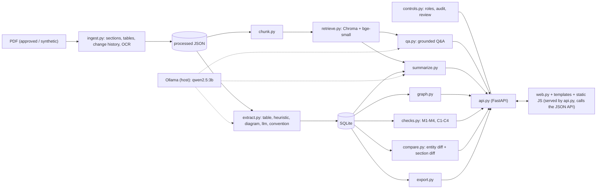
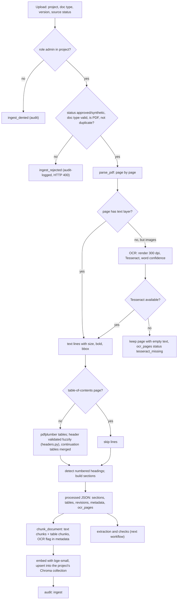
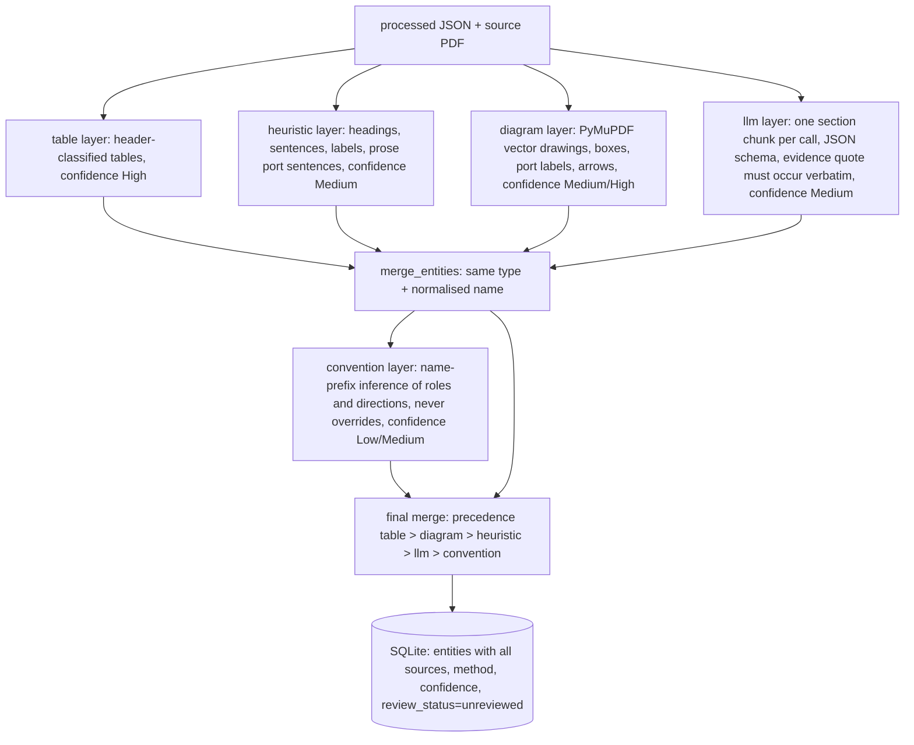
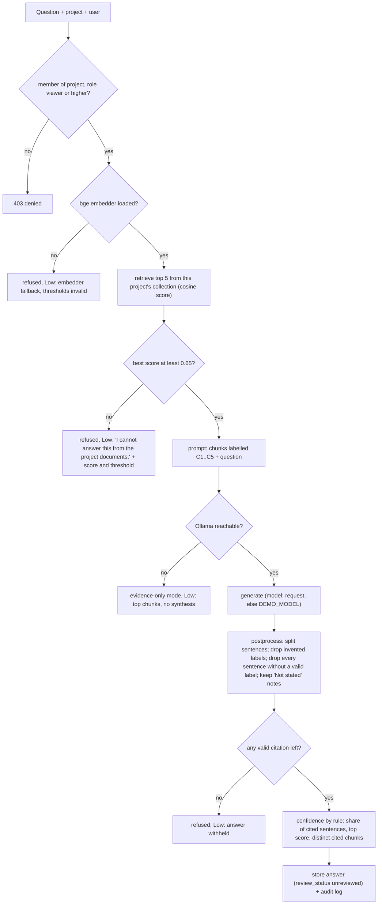
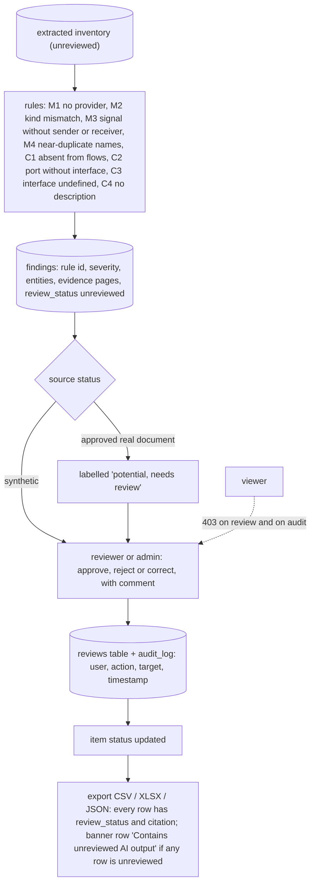

# AUTOSAR HLD Document Analysis Assistant: Technical Report

TechPulse FY-26, Case Study 1. Author: **[AUTHOR]** (name, enrolment id, date). Draft for the author to edit.

How numbers appear in this file: every figure derived from the evaluation is a double-brace placeholder
(path into the results file, optional `|format`) that `scripts/build_report_pdf.py` replaces from `eval/results.json` (path syntax and formats are
documented at the top of that script). A figure that cannot be found prints as "n/a (missing in results.json)".
In this source file the placeholders inside table cells contain a `|`, so read the rendered file
(`docs/TECHNICAL_REPORT.rendered.md`) or the PDF, not the raw table source. Evaluation generated: {{meta.generated}}.

## 1. Problem statement and intended users

AUTOSAR high-level design (HLD) documents describe software components, their ports, interfaces, signals and data flows
across tens to hundreds of PDF pages. Architects, developers, integration engineers and test engineers read them manually
to answer questions such as "which ports does this component have?", "what changed between two releases?" and "is anything
inconsistent?". Manual reading is slow, and mismatches (a required port with no provider, an interface referred to but
never defined, a signal nobody receives, near-duplicate names) are easy to miss. General-purpose chatbots do not fit this
material: they cannot be restricted to approved documents, they do not cite pages, and proprietary design documents must
not leave the machine.

The system is a local, project-scoped pilot that reads approved or synthetic HLD PDFs and produces a cited component
inventory, a dependency graph, rule-based consistency findings, a revision comparison, cited answers and reports, and
reviewed exports. Every output is labelled `unreviewed` until a person approves or rejects it.

Intended users: system and AUTOSAR architects, software developers, integration engineers, test engineers. Out of scope by
design: auto-approving architecture decisions, editing source documents, enterprise single sign-on, ARXML ingestion, and
understanding diagram images with a vision model (`docs/scope.md`, README "Out of scope and scale path").

## 2. Input data / knowledge-base description

| Source | Documents | Status | Notes |
|---|---|---|---|
| AUTOSAR "Explanation of Application Interfaces" PDFs (real) | Body and Comfort R3.1.5 and R3.2.3; Chassis R3.1.5 and R3.2.3; HMI, Multimedia and Telematics R25-11 | `approved` | downloaded from autosar.org by `scripts/download_data.py`; **not committed and not redistributed**; one project per domain (`body-comfort`, `chassis`, `hmi`) |
| Synthetic Window Lift ECU HLD | v1, v2 (8 planted defects, ground truth `data/synthetic/ground_truth.json`), v3 (written in a different style, planted defects in `ground_truth_v3.json`) | `synthetic` | generated by `data/synthetic/generate_*.py`, committed; project `synthetic-ecu` |
| Synthetic Door Control ECU HLD v4 | one document, 6 planted defects | `synthetic` | frozen before the parser generalisation work; sha256 of the PDF, ground truth and generator recorded in `eval/heldout_v4.lock`; used for evaluation only |
| Synthetic scanned sample | `data/synthetic/scanned_sample.pdf` | `synthetic` | pages without a text layer, used to exercise OCR |

Real-document entity counts from the stored inventory (primary run per model, from `eval/results.json`):

| Document | qwen2.5:3b components / ports / interfaces / signals |
|---|---|
| BodyComfort R3.2.3 | {{per_model.qwen2.5:3b.entity_counts.bodycomfort_r3.2.3.components}} / {{per_model.qwen2.5:3b.entity_counts.bodycomfort_r3.2.3.ports}} / {{per_model.qwen2.5:3b.entity_counts.bodycomfort_r3.2.3.interfaces}} / {{per_model.qwen2.5:3b.entity_counts.bodycomfort_r3.2.3.signals}} |
| Chassis R3.2.3 | {{per_model.qwen2.5:3b.entity_counts.chassis_r3.2.3.components}} / {{per_model.qwen2.5:3b.entity_counts.chassis_r3.2.3.ports}} / {{per_model.qwen2.5:3b.entity_counts.chassis_r3.2.3.interfaces}} / {{per_model.qwen2.5:3b.entity_counts.chassis_r3.2.3.signals}} |
| HMI R25-11 | {{per_model.qwen2.5:3b.entity_counts.hmi_r25-11.components}} / {{per_model.qwen2.5:3b.entity_counts.hmi_r25-11.ports}} / {{per_model.qwen2.5:3b.entity_counts.hmi_r25-11.interfaces}} / {{per_model.qwen2.5:3b.entity_counts.hmi_r25-11.signals}} |

The LLM layer adds many component candidates. More is not better by
itself: precision on real documents is unknown (see section 5).

Data characteristics that shaped the design (`docs/data_notes.md`): the real PDFs have few usable tables; ports and signals
are mostly drawn in vector diagrams (boxes, arrows, text labels), which is why a geometry-based extractor exists; text
contains hyphenated line breaks and replacement characters; headings are identified by font size and bold, with numbering.
Chunk metadata carried into the vector store: `project_id`, `doc_id`, `doc_type`, `version`, page range, section id and
title, and an OCR flag with Tesseract confidence for scanned pages.

Controls on the knowledge base: only `approved` or `synthetic` source status is accepted; a rejected upload is audit-logged;
duplicates (same sha256 in a project) and files that are not PDFs are rejected; each project has its own Chroma collection
and `project_id` scope in SQLite.

**[AUTHOR]** confirm the licensing position of using the AUTOSAR PDFs (public download, not redistributed here) and state
what was done to comply.

## 3. Solution architecture

Components and responsibilities:

- **Ingestion** (`app/ingest.py`, `app/ocr.py`, `app/headers.py`, `app/chunk.py`): validates the upload, parses sections,
  tables and the change history, OCRs pages without a text layer, writes a processed JSON, chunks it and indexes it.
- **Extraction** (`app/extract.py`, `app/diagram.py`): five layers (table, heuristic, diagram, llm, convention) merged by
  precedence, every entity keeping all its sources with page and method.
- **Analysis** (`app/graph.py`, `app/checks.py`, `app/compare.py`): dependency graph, eight deterministic rules, entity
  diff and section-level text diff. No LLM is involved in any of these.
- **Language layer** (`app/llm.py`, `app/qa.py`, `app/summarize.py`): local Ollama only, structured and cached calls,
  grounded answers and reports, citation filters.
- **Controls and service** (`app/controls.py`, `app/api.py`, `app/export.py`): roles, project isolation, audit log,
  review decisions, REST API, exports.
- **UI** (`app/web.py`, `app/templates/`, `app/static/`): four screens served by the same FastAPI app as the JSON API:
  Documents (upload and document table), Ask (cited answers), Architecture (inventory, dependency graph, component report
  and flow summary in a side panel) and Review (findings with approve / reject, version comparison, exports). Plain
  Jinja2 page shells, one CSS file and small ES modules; the JavaScript only calls the JSON API with the `X-User`
  header and holds no business logic. Fonts (IBM Plex, OFL) and vis-network (inlined by pyvis) are vendored, so the
  browser makes no request outside the server. The server renders the approve / reject controls only for reviewer
  and admin roles; the API still enforces the role. The audit log has no screen and is read through `GET /audit`.
  Why: a single offline FastAPI service instead of Streamlit: one process, no extra server, works without internet,
  and full control over how citations and confidence are presented.

Design rule: the LLM reads and writes prose; consistency checks are deterministic Python over the extracted inventory, so
a finding can be explained by pointing at the entities and pages that triggered it.

## 4. Implementation and configuration

Full settings, model versions and the exact text of every prompt: `docs/MODEL_CONFIG.md`. Summary: LLM `qwen2.5:3b`
(the only model; default for both evaluation and live demo) through Ollama, 4-bit quantisation (Q4_K_M), `temperature` 0.1,
`num_ctx` 4096; embedder BAAI/bge-small-en-v1.5; chromadb with cosine similarity; chunks of about 500 tokens with 50 tokens
of overlap; Q&A refusal threshold 0.65; High-confidence score 0.75. Python 3.13, Windows, 4 GB GPU.

### 4.1 Ingestion workflow (including OCR)

OCR notes: a page counts as scanned when its text layer has fewer than 20 characters and it contains an image
(`app/ocr.py`). OCR lines carry no font information, so only short "N Title" lines become headings and tables on scanned
pages are plain text. OCR chunks are flagged `ocr` with the mean word confidence, and answers citing them carry the
limitation "from OCR, confidence N". Without the Tesseract binary the page is kept with empty text and a recorded status;
nothing crashes. OCR has no accuracy figure in the evaluation: it is covered by unit tests (`tests/test_ocr.py`) and a
scanned sample. **[AUTHOR]** if you measure OCR character or word accuracy on the scanned sample, add it here.

### 4.2 Extraction layers and merge

Merge rules (`app/extract.py`, `merge_entities`): duplicates (same entity type and normalised name; a port also keys on its
component) are merged; every source (document, version, page, section, method, evidence) is kept; a lower-ranked source
only fills empty or "unknown" fields; the confidence of the best-ranked source is used, and two or more distinct agreeing
methods raise it one step; a convention-only result never exceeds Medium. Re-extraction is idempotent and preserves review
decisions on entities that match.

Anti-hallucination for the LLM layer: the model must return an evidence quote of at most 25 words; the item is discarded
unless the quote occurs verbatim in the section text and the entity name itself occurs in the text and passes a name filter
(no generic words, no figure-text artefacts). Results on the real documents: `{{per_model.qwen2.5:3b.entity_counts.bodycomfort_r3.2.3.components}}`
components for qwen2.5:3b on BodyComfort R3.2.3, far above the deterministic count, because the LLM layer adds many candidates.

### 4.3 Q&A with refusal threshold and citation filter

Confidence is rule-based and never asked of the model (`qa.compute_confidence`): Low when refused, evidence-only, no valid
citation or fewer than half of the generated sentences survived; High when the top score is at least 0.75, at least two
distinct chunks are cited and at least 80% of sentences are cited; Medium otherwise. Citations carry document, version,
page range, section, retrieval score and the OCR note.

### 4.4 Checks, review and human oversight

Rules are pure functions over the inventory (`app/checks.py`); fuzzy matching for M4 uses rapidfuzz with ratio at least 88
on normalised names. Roles are per project (viewer < reviewer < admin) and enforced in the API on every endpoint; the global
admin flag only gates the audit log. Pilot authentication is an `X-User` header naming a seeded user and is **not secure**.

### 4.5 Revision comparison

Two views are produced for two versions of a document:

- **Entity diff** (`compare.compare`): added, removed and changed components, ports, interfaces and signals, keyed by
  normalised name, comparing only meaningful fields; possible renames (fuzzy score at least 88) are listed in addition to
  added/removed; entities supported only by the LLM layer are listed separately as unstable instead of counted as changes.
- **Section diff** (`compare.section_diff`): sections aligned by number and title, then by title alone (renumbering), then
  by fuzzy title (retitled, score at least 85); text compared after removing running headers, footers and release strings,
  reporting added, removed and modified sections with changed sentences and table rows, plus a separate front-matter and
  change-history bucket. Words that merely move between neighbouring sections (figure text crossing a page break) are not
  reported as changes.

### 4.6 Operation

Start-up warm-up (`app/api.py`): the API loads the embedder and sends a one-token prompt to `DEMO_MODEL` in a background
thread; `/health` reports `warming`, `ready` or `degraded` with a reason, and the UI shows a banner until ready. Interactive
requests that name no model use `DEMO_MODEL` (default `qwen2.5:3b`, chosen for latency only). `scripts/demo_reset.py`
rebuilds a clean demo state in a scratch location. Docker: `docker compose config` validates; the image build was not run in
the development session. **[AUTHOR]** state whether you ran `docker compose up` before submission.

## 5. Evaluation steps and results

### 5.1 Method

All commands run from the repository root (`eval/run_eval.py`; full run `python eval/run_eval.py`). The harness uses the
real PDFs, the synthetic documents with ground truth, a 25-question gold set (`eval/gold_questions.json`: 12 real-document,
8 synthetic, 5 unanswerable questions; {{meta.n_questions}} questions in this run) and the local model. Each model gets its own
scratch database; model calls are cached so a re-render does not change numbers.

Steps and what each measures:

1. **Extraction** on synthetic v1/v2, held-out v3 and held-out v4: precision, recall and F1 of component, port, interface and
   signal sets against `ground_truth*.json`, for the deterministic layers alone and with each model's LLM layer.
2. **Planted defects**: findings of the rule engine versus planted defects (found, missed, false positives).
3. **Revision diff**: synthetic v1 to v2, nine expected changes; real release pairs are reported descriptively.
4. **Q&A** over the gold set: answer correctness (all key facts present, string match), key-fact recall, citation accuracy
   (expected document and page), refusal accuracy on unanswerable questions, false-refusal rate, confidence calibration, latency.
5. **Summaries**: share of claim sentences with a valid citation, for component reports and document summaries.
6. **Control tests**: unapproved upload rejected, cross-project query empty, viewer cannot approve, offline run works.
7. **Latency and VRAM** from the LLM traces and sampled GPU memory.
8. **Default-model decision** by a composite rule fixed before the results (mean of Q&A correctness, citation accuracy,
   refusal accuracy, summary groundedness and extraction F1 on v1 and v3).

Held-out discipline: v3 was held out when first scored, then its document was read to diagnose failures, so v3 is
now in-sample for the parser and is labelled so in `eval/results.md`. v4 was generated before the parser changes, its hashes
frozen in `eval/heldout_v4.lock`, and it was scored once after the changes. **Caveat that must be stated:** v4, the
generator and the parser changes were all produced by AI agents in the same working session (separate agents; the parser
agent did not open v4), and the v4 layout brief used header words that also appear in the parser's synonym list. v4 is
therefore a weaker test than an independently written document. **[AUTHOR]** describe any independent check you did.

### 5.2 Extraction (micro-averaged over entity types)

| Document | Deterministic layers only (P / R / F1) | qwen2.5:3b (P / R / F1) |
|---|---|---|
| Synthetic v1 (written to match the parser; upper bound) | {{deterministic.synthetic_v1.syn_hld_v1.micro_all.precision|f2}} / {{deterministic.synthetic_v1.syn_hld_v1.micro_all.recall|f2}} / {{deterministic.synthetic_v1.syn_hld_v1.micro_all.f1|f2}} | {{per_model.qwen2.5:3b.synthetic_v1.syn_hld_v1.micro_all.precision|f2}} / {{per_model.qwen2.5:3b.synthetic_v1.syn_hld_v1.micro_all.recall|f2}} / {{per_model.qwen2.5:3b.synthetic_v1.syn_hld_v1.micro_all.f1|f2}} |
| Synthetic v3 (no longer held-out: in-sample after the parser changes) | {{deterministic.heldout_v3.syn_hld_v3_heldout.micro_all.precision|f2}} / {{deterministic.heldout_v3.syn_hld_v3_heldout.micro_all.recall|f2}} / {{deterministic.heldout_v3.syn_hld_v3_heldout.micro_all.f1|f2}} | {{per_model.qwen2.5:3b.heldout_v3.syn_hld_v3_heldout.micro_all.precision|f2}} / {{per_model.qwen2.5:3b.heldout_v3.syn_hld_v3_heldout.micro_all.recall|f2}} / {{per_model.qwen2.5:3b.heldout_v3.syn_hld_v3_heldout.micro_all.f1|f2}} |
| Synthetic v4 (held-out, frozen, scored once) | {{deterministic.heldout_v4.syn_hld_v4_heldout.micro_all.precision|f2}} / {{deterministic.heldout_v4.syn_hld_v4_heldout.micro_all.recall|f2}} / {{deterministic.heldout_v4.syn_hld_v4_heldout.micro_all.f1|f2}} | {{per_model.qwen2.5:3b.heldout_v4.syn_hld_v4_heldout.micro_all.precision|f2}} / {{per_model.qwen2.5:3b.heldout_v4.syn_hld_v4_heldout.micro_all.recall|f2}} / {{per_model.qwen2.5:3b.heldout_v4.syn_hld_v4_heldout.micro_all.f1|f2}} |

Reading the table: v1 only shows the parser fits documents it was written for. Before the generalisation work, the
deterministic layers found nothing on v3 (the then-held-out result: qwen2.5:3b F1 0.25, recorded in
`eval/v3_after_parser_changes.md`); v4 is the generalisation result. **[AUTHOR]** add one sentence interpreting the v4 row once the
final numbers are in, and say what kinds of layout it would still fail on.

Real documents: **no verified precision or recall is reported.** `eval/real_gold.csv` status: {{real_gold.status}}
(verified rows: {{real_gold.n_verified_rows}}). **[AUTHOR]** if you finish verifying `eval/real_gold_candidates.csv` and
re-run the evaluation, replace this paragraph with the real-data P/R.

### 5.3 Planted defects and revision diff

| Check | Deterministic only | qwen2.5:3b |
|---|---|---|
| v1: planted defects found (of {{deterministic.defects_v1.n_planted}}) / false positives | {{deterministic.defects_v1.found|len}} / {{deterministic.defects_v1.false_positives|len}} | {{per_model.qwen2.5:3b.defects_v1.found|len}} / {{per_model.qwen2.5:3b.defects_v1.false_positives|len}} |
| v3: found (of {{deterministic.defects_v3.n_planted}}) / false positives (in-sample) | {{deterministic.defects_v3.found|len}} / {{deterministic.defects_v3.false_positives|len}} | {{per_model.qwen2.5:3b.defects_v3.found|len}} / {{per_model.qwen2.5:3b.defects_v3.false_positives|len}} |
| v4 (held-out): found (of {{deterministic.defects_v4.n_planted}}) / false positives | {{deterministic.defects_v4.found|len}} / {{deterministic.defects_v4.false_positives|len}} | {{per_model.qwen2.5:3b.defects_v4.found|len}} / {{per_model.qwen2.5:3b.defects_v4.false_positives|len}} |
| v1 to v2 diff: true positives / false negatives / false positives (accuracy) | {{deterministic.diff_v1_v2.tp}} / {{deterministic.diff_v1_v2.fn}} / {{deterministic.diff_v1_v2.fp}} ({{deterministic.diff_v1_v2.accuracy|pct}}) | {{per_model.qwen2.5:3b.diff_v1_v2.tp}} / {{per_model.qwen2.5:3b.diff_v1_v2.fn}} / {{per_model.qwen2.5:3b.diff_v1_v2.fp}} ({{per_model.qwen2.5:3b.diff_v1_v2.accuracy|pct}}) |

The checks are deterministic, so differences between the model columns come only from which entities the extractor found.
The real-release entity diff (R3.1.5 to R3.2.3) found no entity changes for the two domains tested; the section diff and
the change-history tables are the informative view there. The section diff has unit tests (`tests/test_section_diff.py`) but
no accuracy figure. **[AUTHOR]** add the section-diff output you captured for BodyComfort R3.1.5 to R3.2.3 (screenshot, section 8).

### 5.4 Question answering (gold set of {{meta.n_questions}} questions)

| Metric | qwen2.5:3b |
|---|---|
| Answer correctness (all key facts present) | {{per_model.qwen2.5:3b.qa.summary.answer_correctness|pct}} |
| Key-fact recall | {{per_model.qwen2.5:3b.qa.summary.key_fact_recall|pct}} |
| Citation accuracy (expected document and page) | {{per_model.qwen2.5:3b.qa.summary.citation_accuracy|pct}} |
| Citation accuracy (expected section) | {{per_model.qwen2.5:3b.qa.summary.section_accuracy|pct}} |
| Claim sentences with a valid citation (after filtering) | {{per_model.qwen2.5:3b.qa.summary.groundedness_sentences_cited|pct}} |
| Lexical support of cited claims | {{per_model.qwen2.5:3b.qa.summary.lexical_support_share|pct}} |
| Refusal accuracy on unanswerable questions | {{per_model.qwen2.5:3b.qa.summary.refusal_accuracy_unanswerable|pct}} |
| False-refusal rate on answerable questions | {{per_model.qwen2.5:3b.qa.summary.false_refusal_rate_answerable|pct}} |
| End-to-end latency p50 / p95 (n = {{per_model.qwen2.5:3b.qa.summary.latency_wall_ms.n}}) | {{per_model.qwen2.5:3b.qa.summary.latency_wall_ms.p50_ms|s}} / {{per_model.qwen2.5:3b.qa.summary.latency_wall_ms.p95_ms|s}} |

Confidence calibration (accuracy of answers per confidence level):

| Confidence | qwen2.5:3b (n, accuracy) |
|---|---|
| High | {{per_model.qwen2.5:3b.qa.summary.calibration.High.n}}, {{per_model.qwen2.5:3b.qa.summary.calibration.High.accuracy|pct}} |
| Medium | {{per_model.qwen2.5:3b.qa.summary.calibration.Medium.n}}, {{per_model.qwen2.5:3b.qa.summary.calibration.Medium.accuracy|pct}} |
| Low | {{per_model.qwen2.5:3b.qa.summary.calibration.Low.n}}, {{per_model.qwen2.5:3b.qa.summary.calibration.Low.accuracy|pct}} |

Caveats that belong next to these numbers: one question is four percentage points; correctness is a key-fact string match
and can under-count correct paraphrases; groundedness is high partly by construction because uncited sentences are removed
before display (the harness also records the share the model cited unprompted); lexical support is a weak proxy for
entailment; Low-confidence answers are mostly refusals, so Low accuracy does not show that Low is reliable; the gold set was
written by the project author (**[AUTHOR]** state who wrote and who checked the expected answers).

### 5.5 Summaries, controls, resources

| Item | qwen2.5:3b |
|---|---|
| Component reports: claim sentences cited | {{per_model.qwen2.5:3b.summaries.summary.component_groundedness|pct}} |
| Document summaries: claim sentences cited | {{per_model.qwen2.5:3b.summaries.summary.document_groundedness|pct}} |
| Extraction latency per LLM call p50 / p95 | {{latency.qwen2.5:3b.extract_per_call.p50_ms|s}} / {{latency.qwen2.5:3b.extract_per_call.p95_ms|s}} |

Control tests (run once): unapproved upload rejected = {{controls.results.unapproved_upload_rejected.passed}}; cross-project query
returns nothing = {{controls.results.cross_project_query_empty.passed}}; viewer cannot approve = {{controls.results.viewer_cannot_approve.passed}};
offline run works (HF offline flags, extraction and Q&A) = {{controls.results.offline_run_works.passed}}. The offline test blocks sockets
and sets the Hugging Face offline flags; the network adapter was not physically disconnected.

GPU: peak {{vram.peak_mib|int}} MiB of {{vram.total_mib|int}} MiB observed during the whole run (one 3B model resident at a time).

Model: `qwen2.5:3b`, the only configured model (author decision); no model comparison is made.

### 5.6 Not measured

- Review-effort reduction (manual versus tool-assisted review): the protocol and timer exist (`docs/review_effort_protocol.md`,
  `scripts/review_timer.py`). **[AUTHOR]** insert the measured times, reviewer count, order and the learning-effect caveat, or
  state that it was not measured.
- Real-document extraction precision and recall (needs the verified gold file).
- OCR accuracy, section-diff accuracy, and answer quality on documents outside the five AUTOSAR PDFs and the synthetic set.

### 5.7 Tests

**[AUTHOR]** paste the final `pytest -q` summary line (the suite uses temporary databases and a hashing embedder, so it needs
neither Ollama nor the network). Tests marked `llm` call a live model and are deselected by default; one of them has failed
intermittently because a 3B model returned no entities for one section (non-deterministic).

## 6. Responsible AI

**Grounding.** Answers are limited to retrieved chunks from the user's project. Three layers act before the user sees text:
a similarity threshold (refusal when the best retrieval score is below 0.65, a setting chosen on the project's own questions, see `docs/MODEL_CONFIG.md`),
a prompt that demands a chunk label on every sentence, and a post-filter that removes sentences without a valid label and strips
invented labels. Report sentences additionally need at least 40% lexical overlap with the cited text, and may be re-pointed to the
chunk that supports them. LLM-extracted entities need a verbatim evidence quote. If nothing valid survives, the system returns a
refusal rather than an unsupported answer. Limits: lexical overlap does not prove entailment, and a sentence can be cited to a chunk
that is relevant but does not say what the sentence says.

**Uncertainty and labelling.** Every answer has a rule-based confidence and a limitation text; every entity, finding, report and answer
starts as `unreviewed`; findings on real documents are "potential, needs review"; OCR-derived text is flagged; exports carry the status
and a banner row. Confidence is not calibrated (section 5.4).

**Privacy and data handling.** Models run locally through Ollama; embeddings run on the local CPU; nothing is sent to a cloud service and
no API key exists in the project. Documents are processed into local files (SQLite, Chroma, JSON). The LLM response cache and the call trace
store prompts and responses locally, so they contain document text and must be protected like the documents. The real PDFs are downloaded by
the user and are neither committed nor copied into container images. **[AUTHOR]** confirm what real or proprietary data, if any, was used.

**Security.** Project isolation (separate collection per project, `project_id` filter on every query, membership check on every endpoint), roles
enforced server-side, audit log of ingestion, rejections, questions and reviews. Known weaknesses: the pilot identifies users by an `X-User`
header with no password or token, so anyone who can reach the API can claim any user; the API is meant for localhost only. Uploaded PDFs are
parsed by PyMuPDF and pdfplumber, so a malicious PDF is a parser attack surface; only admins can upload. PyMuPDF is AGPL-3.0 (see
`docs/CITATIONS.md` for the implication). Prompt injection: text inside a PDF is placed in the prompt as evidence; the citation filter limits
what can be displayed, but a hostile document could still steer the wording of a cited sentence. **[AUTHOR]** add any injection test you ran.

**Human oversight.** No output is final: reviewers approve, reject or correct each item with a comment, viewers cannot review, admins see the
audit log, and approved status travels into exports. The system does not change source documents and does not approve architecture decisions.

**Fairness and bias.** The inputs are technical documents without personal data, so demographic fairness is not in scope. The relevant bias is
coverage: the parser and thresholds were tuned on five AUTOSAR PDFs and synthetic documents written by the same author or agents, so performance on
other vendors' layouts is unknown (section 5.2).

**Model licences and AI assistance.** `docs/MODEL_CONFIG.md` lists model licences; `docs/AI_TOOL_DECLARATION.md` declares AI tools used to build the
project.

## 7. Innovation highlights

1. **Diagram-geometry extraction** (`app/diagram.py`). The real AUTOSAR documents draw ports and signals as vector graphics, not as tables. The
   extractor reads PyMuPDF drawing primitives: boxes become components, tiny squares and labels near a box border become ports (provided when an
   arrow starts at the port's border position, required when one ends there), `Name / kind` labels on arrows become signals with sender and receiver found by which box the arrow ends touch. All
   thresholds are settings. This is what produces the port inventory for BodyComfort (diagram-sourced entities dominate the method counts in
   `eval/results.md`) without a vision model on a 4 GB GPU.
2. **Evidence-quote check** (`app/extract.py`). LLM extraction is constrained by a JSON schema, and each item must carry a quote of at most 25
   words that is found verbatim (case and whitespace insensitive) in the section; otherwise it is dropped. This converts "the model said so" into a
   checkable claim and rejects most noisy candidates (the harness records how many).
3. **Local-only operation with an LLM cache** (`app/llm.py`). Provider abstraction accepts only local Ollama or none, rejects cloud names, caches
   every response by hash of model, system prompt, prompt and schema, and traces every call. The cache makes evaluation re-renders and demo replays
   repeatable and fast; the `none` provider gives an evidence-only mode when no model is available.
4. **Citation filter and rule-based confidence** (`app/qa.py`, `app/summarize.py`). Unsupported sentences are removed rather than flagged, and
   confidence is computed from retrieval score, distinct cited chunks and cited-sentence share.
5. **Section-level revision diff** (`app/compare.py`). Aligns sections across releases (renumbered, retitled), ignores running headers and moved
   figure text, and reports modified sentences and table rows, which is needed because entity-level diffs of the real releases are empty.
6. **OCR path with provenance** (`app/ocr.py`). Scanned pages are read with Tesseract; confidences flow into chunk metadata and into the
   limitation text of answers, so a reader knows when a citation rests on OCR.
7. **Parser generalisation with a frozen held-out test** (`app/headers.py`, `eval/heldout_v4.lock`). Fuzzy header matching and value-pattern column
   inference replaced exact header lists, and the claim is tested on a document whose hash was recorded before the change.

**[AUTHOR]** keep the items you can defend in the viewing; drop any you cannot explain (see `docs/CODE_WALKTHROUGH.md`).

## 8. Screenshots, logs and evidence

Capture these and insert them (file names are suggestions). **[AUTHOR]** for every row.

| # | Evidence | What it proves | Capture | File |
|---|---|---|---|---|
| 1 | Documents screen: rejected draft upload with the reason inline, then `GET /audit` row `ingest_rejected` | controlled ingestion | **[AUTHOR]** | `evidence/01_reject.png` |
| 2 | Ask screen: answer with citation tags, source list, confidence, model name | grounded answer | done | `docs/screenshots/ask.png` |
| 3 | Refusal with the threshold limitation text | refusal threshold | done | `docs/screenshots/ask_refusal.png` |
| 4 | Architecture screen: inventory tabs and dependency graph | extraction and dependency map | done | `docs/screenshots/architecture.png` |
| 5 | Component report side panel and flow summary with citation tags | cited reports | done (component report) | `docs/screenshots/architecture.png` |
| 6 | Review screen with the planted defects grouped by rule and page tags | rule-based checks | done | `docs/screenshots/review.png` |
| 7 | Review: viewer sees no review buttons (API 403), reviewer approve and reject, admin `GET /audit` | human oversight and roles | **[AUTHOR]** | `evidence/07_review_audit.png` |
| 8 | Review screen, Compare versions: entity diff and section diff | revision comparison | done (synthetic v1 vs v2) | `docs/screenshots/review.png` |
| 9 | Project isolation: same question in another project refused | isolation | **[AUTHOR]** | `evidence/09_isolation.png` |
| 10 | Excel export with banner row and `review_status` column | export and unreviewed labelling | **[AUTHOR]** | `evidence/10_export.png` |
| 11 | Scanned sample ingested with OCR flag and confidence in the citation | OCR | **[AUTHOR]** | `evidence/11_ocr.png` |
| 12 | `/health` JSON showing `warmup: ready`, models, embedder | operation | **[AUTHOR]** | `evidence/12_health.png` |
| 13 | Terminal: `python eval/run_eval.py` summary and the generated `eval/results.md` | evaluation run | **[AUTHOR]** | `evidence/13_eval.png` |
| 14 | Terminal: `pytest -q` result | tests | **[AUTHOR]** | `evidence/14_pytest.png` |
| 15 | A few lines of `data/traces.jsonl` (model, purpose, latency, cached) | local-only LLM logging | **[AUTHOR]** | `evidence/15_trace.png` |
| 16 | `eval/heldout_v4.lock` and its git commit date | held-out freeze | **[AUTHOR]** | `evidence/16_lock.png` |
| 17 | Offline run (Wi-Fi off) answering a question | local-only claim | **[AUTHOR]** | `evidence/17_offline.png` |
| 18 | Review-effort table from `scripts/review_timer.py` (if measured) | review effort | **[AUTHOR]** | `evidence/18_review_effort.png` |

Charts generated by the evaluation are in `eval/charts/` (extraction F1, Q&A metrics, latency, entity counts before and after the uplift).

## 9. Reflection and conclusions

**[AUTHOR]** write this section yourself. Points an assessor will look for, with the facts available from the project:

- What worked: deterministic checks and the table/diagram layers on documents they fit; the citation filter and refusal behaviour; local-only
  operation on a 4 GB GPU.
- What did not: extraction on unseen layouts before the generalisation work; real-document port inventories for Chassis and HMI; calibration of
  High/Medium/Low; LLM-layer instability between models and releases; review effort not (or only partly) measured.
- What you would do differently, and what you learned from using AI coding assistants (`docs/AI_TOOL_DECLARATION.md`), including how you verified their output.
- What is needed to move from pilot to use: verified real gold set, independent test documents, real authentication, vector store and graph store at
  scale, review-effort study with more than one reviewer.
- Honest statement of what you personally wrote, understood and can explain.
